<picture><source media="(max-width: 600px) and (prefers-color-scheme: dark)" srcset="profile-assets/hero-mobile-dark-b8839153f63e.svg"><source media="(max-width: 600px)" srcset="profile-assets/hero-mobile-light-8b6e0a09755e.svg"><source media="(prefers-color-scheme: dark)" srcset="profile-assets/hero-dark-c2501484939d.svg"></picture>

<a href="https://t.me/miroshka000"><picture><source media="(prefers-color-scheme: dark)" srcset="profile-assets/button-1-dark-195b69e11339.svg"></picture></a>&nbsp;&nbsp;<a href="https://github.com/Miroshka000?tab=repositories"><picture><source media="(prefers-color-scheme: dark)" srcset="profile-assets/button-2-dark-fe5d6f27fe35.svg"></picture></a>

<picture><source media="(max-width: 600px) and (prefers-color-scheme: dark)" srcset="profile-assets/about-mobile-dark-28cbbb842ded.svg"><source media="(max-width: 600px)" srcset="profile-assets/about-mobile-light-51d7523f660c.svg"><source media="(prefers-color-scheme: dark)" srcset="profile-assets/about-dark-8a430f34dc4a.svg"></picture>

<picture><source media="(max-width: 600px) and (prefers-color-scheme: dark)" srcset="profile-assets/stack-mobile-dark-ba950bd00d00.svg"><source media="(max-width: 600px)" srcset="profile-assets/stack-mobile-light-3bf654ccf6d0.svg"><source media="(prefers-color-scheme: dark)" srcset="profile-assets/stack-dark-fcdd6b49602c.svg"></picture>

<a href="https://github.com/Miroshka000/mikan"><picture><source media="(prefers-color-scheme: dark)" srcset="profile-assets/project-mikan-dark-7f0230777798.svg"></picture></a>&nbsp;<a href="https://github.com/getmikan/MikanApp"><picture><source media="(prefers-color-scheme: dark)" srcset="profile-assets/project-mikanapp-dark-2472acaa63fa.svg"></picture></a>

<a href="https://github.com/getmikan/marketplace"><picture><source media="(prefers-color-scheme: dark)" srcset="profile-assets/project-marketplace-dark-4322d596d061.svg"></picture></a>&nbsp;<a href="https://github.com/getmikan/Citrus"><picture><source media="(prefers-color-scheme: dark)" srcset="profile-assets/project-citrus-dark-7737235befb3.svg"></picture></a>

<picture><source media="(max-width: 600px) and (prefers-color-scheme: dark)" srcset="profile-assets/stats-mobile-dark-d4978535be16.svg"><source media="(max-width: 600px)" srcset="profile-assets/stats-mobile-light-d3477277d8c3.svg"><source media="(prefers-color-scheme: dark)" srcset="profile-assets/stats-dark-c7e7b82e9cf8.svg"></picture>

<picture><source media="(max-width: 600px) and (prefers-color-scheme: dark)" srcset="profile-assets/wave-mobile-dark-d2a1a4d19924.svg"><source media="(max-width: 600px)" srcset="profile-assets/wave-mobile-light-2d6c388e70bd.svg"><source media="(prefers-color-scheme: dark)" srcset="profile-assets/wave-dark-39595edb77ec.svg"></picture>

<a href="https://metawka.github.io/expressive-profile/?from=Miroshka000"><picture><source media="(prefers-color-scheme: dark)" srcset="profile-assets/credit-dark-e13883bf7dcf.svg"></picture></a>

