<picture><source media="(max-width: 600px) and (prefers-color-scheme: dark)" srcset="profile-assets/hero-mobile-dark.svg"><source media="(max-width: 600px)" srcset="profile-assets/hero-mobile-light.svg"><source media="(prefers-color-scheme: dark)" srcset="profile-assets/hero-dark.svg"></picture>

<a href="https://t.me/miroshka000"><picture><source media="(prefers-color-scheme: dark)" srcset="profile-assets/button-1-dark.svg"></picture></a>&nbsp;&nbsp;<a href="https://github.com/Miroshka000?tab=repositories"><picture><source media="(prefers-color-scheme: dark)" srcset="profile-assets/button-2-dark.svg"></picture></a>

<picture><source media="(max-width: 600px) and (prefers-color-scheme: dark)" srcset="profile-assets/about-mobile-dark.svg"><source media="(max-width: 600px)" srcset="profile-assets/about-mobile-light.svg"><source media="(prefers-color-scheme: dark)" srcset="profile-assets/about-dark.svg"></picture>

<picture><source media="(max-width: 600px) and (prefers-color-scheme: dark)" srcset="profile-assets/stack-mobile-dark.svg"><source media="(max-width: 600px)" srcset="profile-assets/stack-mobile-light.svg"><source media="(prefers-color-scheme: dark)" srcset="profile-assets/stack-dark.svg"></picture>

<a href="https://github.com/Miroshka000/mikan"><picture><source media="(prefers-color-scheme: dark)" srcset="profile-assets/project-mikan-dark.svg"></picture></a>&nbsp;<a href="https://github.com/getmikan/MikanApp"><picture><source media="(prefers-color-scheme: dark)" srcset="profile-assets/project-mikanapp-dark.svg"></picture></a>

<a href="https://github.com/getmikan/marketplace"><picture><source media="(prefers-color-scheme: dark)" srcset="profile-assets/project-marketplace-dark.svg"></picture></a>&nbsp;<a href="https://github.com/getmikan/Citrus"><picture><source media="(prefers-color-scheme: dark)" srcset="profile-assets/project-citrus-dark.svg"></picture></a>

<picture><source media="(max-width: 600px) and (prefers-color-scheme: dark)" srcset="profile-assets/stats-mobile-dark.svg"><source media="(max-width: 600px)" srcset="profile-assets/stats-mobile-light.svg"><source media="(prefers-color-scheme: dark)" srcset="profile-assets/stats-dark.svg"></picture>

<a href="https://metawka.github.io/expressive-profile/?from=Miroshka000"><picture><source media="(prefers-color-scheme: dark)" srcset="profile-assets/credit-dark.svg"></picture></a>

